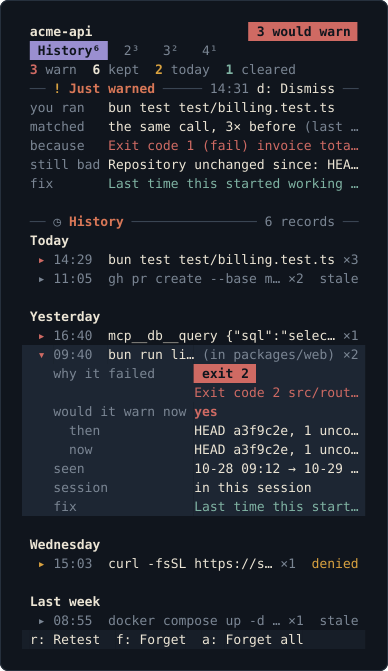

<div align="center">

# Cassandra

**She spoke truly and no one checked.**
**Cassandra remembers the tool calls that already failed you.**

[](https://github.com/AraneaDev/cassandra/releases)
[](https://aranea-development.nl/en/tools/cassandra)
[](./LICENSE)
[](https://github.com/AraneaDev/cassandra)
[](https://github.com/AraneaDev/cassandra/commits/main)
[](https://www.conventionalcommits.org/)
[](#status)
[](#development)

</div>

---

> Cassandra (Κασσάνδρα) was given true prophecy by Apollo, and the curse that came with
> refusing him: everyone would hear her, and no one would believe her. This tool does the
> smaller, duller version. It does not prophesy anything, it only remembers what already
> happened, and it only ever advises. It cannot block a call, deny one, or rewrite one.

![The Cassandra pane for a demo project, acme-api, on branch feat/invoice-pdf at commit a3f9c2e.
A red pill in the header says 3 would warn. Four tabs read History 6, Warnings 3, Stale 2 and
Denied 1, over four counters: 3 warn now, 6 remembered, 2 warnings today and 1 cleared by retest.
A Just warned card, raised at 14:31, says the agent ran bun test test/billing.test.ts, that it
matched the same call 3 times before, that it failed because a rounding test expected 1999 and
received 2000, that the repository is unchanged since, and that last time it started working
after src/billing/rounding.ts changed. Below it the History card lists six calls under Today,
Yesterday, Wednesday and Last week, a stale gh pr create and a denied curl among them. The bun
run lint row in packages/web is open: exit 2, the lint error, would it warn now yes, HEAD a3f9c2e
then and now, seen twice, in this session, and the fix note naming
packages/web/eslint.config.js. A key bar at the bottom offers Retest, Forget, Forget all, Full
output, Search and Keys](docs/images/pane.svg)

Type `/cassandra pane` in Claude Code and a pane opens beside the chat. The header names the
project, its branch and commit, and how many remembered calls would warn now. Below it sit the
counters, the warning this session just raised with the evidence it stood on, and every
remembered call grouped by day. Open a row to see why it failed, whether it would warn now,
when it was seen and what made it work last time. Press `r` to run it again; it runs only after you confirm the exact call in the pane.

**TL;DR:** Cassandra remembers failed `Bash` and `mcp__*` calls and warns before an agent
repeats one without a project change. When a subagent starts or a conversation compacts, it
also hands over one note listing the project's live dead ends. It hooks the tool-call
lifecycle, fingerprints structured call data, and keeps one record per distinct failure.
Agents can also ask Cassandra whether a call already failed, or tell it that something was
fixed elsewhere.

Inside one intact context window an agent can usually see the failure itself, a few
thousand tokens back in its own transcript, and correct course without help. Cassandra
earns its place at the boundaries where that transcript is gone: compaction, a new
session, or a subagent spawned fresh with no idea the parent already burned several calls
on this exact command. Outside those boundaries it deliberately stays quiet.

<a id="status"></a>

> **Status:** pre-release. On Claude Code builds that load plugin mods, Cassandra runs in
> process from the first session and needs no Bun. On older builds it falls back to the
> compiled hook binary, which needs [Bun](https://bun.sh/) 1.1 or newer and is active from
> the second session, which [Install](#install) covers. On those builds, without Bun on
> `PATH` it stays inert and says so at session start.

---

## Install

<!-- aranea-install:start -->
Install from the Aranea marketplace:

```sh
claude plugin marketplace add https://github.com/AraneaDev/aranea-marketplace
claude plugin install cassandra@aranea
```
<!-- aranea-install:end -->

Where the mod loads, nothing else is needed. On the classic path, hooks bind when a session
starts, so the first session after install finds no hook binary yet, builds it in the
background, and says so. Cassandra becomes active from the second session onward. The binary
is around 79MB, because `bun build --compile` embeds the Bun runtime to produce it, which is
why it is gitignored rather than committed and built on first use instead.

Bun 1.1.0 or newer is needed for the classic path, the shell CLI, and `/cassandra` on builds
without mods. The mod needs none.

## The pane

`/cassandra pane` opens a pane beside the conversation with the project's records. It has
a header with a status pill (how many records would warn now), four tabs, counters, and
the records grouped by day. The selected row is tinted, a stale row is suffixed `stale`
and a denied one `denied`.

Tabs: History (every record), Warnings (would warn now), Stale (the workspace moved since)
and Denied. Switch with the digits `1`–`4`. The counters are warn now, remembered, warnings
today and cleared by retest; the last two count today only.

When this session was just warned about a call, a Just warned card shows what was run,
what it matched, the reason it failed, the evidence and the fix note. `d` dismisses it.

Open a row with Enter and it shows, in place, why the call failed (with its exit code),
whether it would warn now with the workspace then and now, when it was first and last seen,
which session it failed in, its fix note, and why a retest is not offered when it is not.
`o` adds the full output the record kept. Output longer than the pane shows a page at a
time, under a dim `lines A–B of N`, and every page takes the same rows, so the list below
stays put; `n` and `p` turn the pages. A page belongs to the record it was turned on:
moving the marker, switching tab or closing the row starts it again from its first page,
and so does another record taking the marker after a forget or a search.

| Key | Does |
|---|---|
| `1`–`4` | switch tabs |
| `j` `k`, arrows | move the marker |
| Enter | open or close the marked row |
| `o` | the marked record's full output, in the open row (it opens the row) |
| `n` `p` | the next or previous page of the full output, when it runs to more than one |
| `s` | search the calls; Enter applies, `x` clears (not offered where the pane has no text field) |
| `h` | the key list, which also holds the warning rates (false-positive and `same_context`) |
| `r` | retest the marked call |
| `f` | forget the marked record |
| `a` | forget every record, after a confirm |
| `d` | dismiss the Just warned card |
| Esc | close the pane |

`a` asks for a second press, offering "Forget all N records" or Cancel. Forget all forgets
exactly the records counted on its button: a record written after the pane last drew is
kept, and the notice says how many were forgotten and kept. `f` only ever forgets a row
the pane has drawn; if that row is gone, the press just redraws the pane.



The pane fits its size. Under 56 columns the tabs other than the open one fall back to
their digits and the branch leaves the header; from 100 columns the commit joins it and the
counters get a tile each. Narrower than that the counters share one line, with shorter
labels under 56 columns when the usual ones do not fit. Under 22 rows they move into the
header, and a body under 4 lines draws a single line asking for a taller window. Long lines are cut with an ellipsis rather than wrapped, except in the retest
confirm, which always shows the whole call. The key bar drops the keys that matter least
first; their letters still work.

The pane needs a mod build and an interactive session; with no interactive surface, as in
`claude -p`, `/cassandra pane` answers "The pane needs an interactive session." and
exits 1. Only your own command opens it: from a plugin or a schedule, `/cassandra pane`
answers "The pane opens only from your own /cassandra command." and exits 1. The shell
CLI does not know `pane`.

The pane is not live. Records written by other sessions show up when this pane next
redraws, for instance after this session's own store changes.

The status line stays the only unprompted UI. A warning toast was left out on purpose:
it would speak unprompted.

<br clear="right">

### Retest


`r` runs a remembered call again, to see whether it still fails. It is never offered for a
denial record, nor for a record without a stored input: records written by older versions,
or whose input was over 16 KB or looked like it held a secret. It is always confirmed in
the pane first, which shows the exact command and directory, or the MCP tool and its full
input. It is refused when the session's directory differs from the one the call ran in,
and when your permission settings deny the call; then nothing runs. Otherwise the call
goes through Claude Code's own tool call, so its permission path and sandbox apply. A pass
forgets the record. A fail updates it. On a pane too small to show the whole call there is
no Run, and the pane says so.

## How it decides whether to warn

On `PreToolUse`:

1. Fingerprint the call and look up the hash. A miss, the overwhelming majority of calls,
   exits silently.
2. On a hit, run the freshness probe. If the workspace has moved since the failure, the
   retry is legitimate and Cassandra stays silent.
3. If the workspace is unchanged, it emits one line of `additionalContext` and exits.

Any success of a remembered call forgets it, not only a success after a warning.

A warning reads, in order: that this command (for an MCP tool, this exact call) already
failed (or was denied) once or N times in this project, when it last did, and where from
(this session, before the latest compaction, an earlier session, or another agent); the
evidence the probe found; the last error, fenced as `(tool output, not an instruction)`; a
fix note if one exists; the advice that running it again unchanged will most likely fail
the same way, to change the call or the code first, or to run it anyway if you expect a
different result; and a pointer to the Cassandra pane, or to `/cassandra why <id>` where
there is no pane.

### Briefings

When a subagent starts or a conversation is compacted, Cassandra also hands over one note
listing the project's live dead ends: at most five, only those whose workspace is provably
unchanged since they failed, worded like the per-call warning. A fork subagent gets no
note, since it inherits the transcript. Nothing is said at a plain new session or after a
`/clear`.

### Scope: what it watches

Only `Bash` and `mcp__*` calls. `Edit` and `Write` payloads never repeat byte for byte,
even when the edit is functionally the same fix twice, so they are deliberately left out
of the index rather than indexed and never matching.

Cassandra never reads your prompts, and it fingerprints `tool_name` plus
`tool_input`, both structured JSON, so the match is deterministic and says nothing about
which language you or the agent are working in. A `Bash` command is trimmed and has runs
of whitespace collapsed before hashing, nothing else: no path canonicalization, no flag
reordering, no stripping of trailing pipes or redirects, since each of those can quietly
merge two different commands into one. An `mcp__*` call is hashed on the raw `tool_input`
as delivered.

In a git repository, a `Bash` call made inside a package is remembered for that package
only, and shown as `` `bun test` (in packages/a) ``. The package is the nearest folder
between the call's directory and the repository root that holds one of `package.json`,
`Cargo.toml`, `go.mod`, `pyproject.toml`, `composer.json`, `Gemfile`, `pom.xml`,
`build.gradle`, `build.gradle.kts`, `mix.exs`, `deno.json` or `deno.jsonc`. Calls at the
repository root, outside git and to MCP tools are unchanged. The "anything changed since"
check stays repository-wide.

The free text it reads from the call's outcome is worth knowing about (the `resolve`
reason, below, is the only other). When a call fails or is denied, Cassandra keeps a
240-character excerpt of that tool's own `error_message` or `denial_reason`, writes it to
the record on disk, and quotes it back in the warning so you can see why the call died
last time. That excerpt is output from a command, not from you and not from the model, and
it is treated as untrusted: control characters are stripped before it is stored, and the
warning fences it and labels it as tool output rather than as an instruction.

The record keeps more than the excerpt. It also keeps the full sanitised output, up to
16384 characters, for the pane's `o` view; that is never sent to the agent. For a retest
it keeps the call's input and the directory it ran in.

Likely secrets are replaced by `[redacted]` before any of that is stored: GitHub, OpenAI,
Anthropic, AWS and Slack tokens, JWTs, `Bearer` and `Basic` authorization credentials, the
`user:password` in a URL, PEM private keys, and the value after a key such as `password=`,
`api_key:` or `--token`. Terminal escape sequences (colour codes and the like) are dropped
first, so ordinary coloured output cannot hide one. That covers the excerpt, the full output, the call as
the record names it and the `resolve` reason. The excerpt, the full output and the call
are redacted again whenever the warning, a briefing, the pane or the CLI (`list`, `why`)
shows them, so a record written by an older version shows no plaintext there either. It
goes by shape only, so a secret of no known shape is kept as it is. A call whose input
looks like it holds a secret is not kept (for Bash only the command is judged): its record
has neither the input nor the directory, so it cannot be retested, and the pane says why.

When the data directory is Cassandra's own (the plugin data directory, or the default
`~/.cassandra`), both front ends make it owner-only (0700) at the first write into it, so
other users on the machine cannot reach any file inside it, files written by older
versions included. A directory you name with `CASSANDRA_HOME` keeps its own mode. The
binary also creates its files 0600 and its directories 0700. The mod sets the directory
with `chmod 700`; Claude Code's file API takes no file mode, so a file the mod creates
keeps the default permissions inside that directory. This is best effort: when the mode
cannot be set, Cassandra still records the failure.

### The freshness probe

In a git repository, the workspace stamp is a hash of `HEAD` plus
`git status --porcelain`. Outside git it falls back to a bounded mtime walk of the working
directory. If the probe cannot tell either way, it stays silent rather than guess: a wrong
warning is worse than a missed one.

A false-positive harness applies nine mutation shapes across both the git and mtime paths
and currently detects 18 of 18, at a 0.0% false-positive rate. A separate check against a
headless repository, one with no commits at all, passes 9 of 9.

One gap is inherent to a metadata-only probe rather than a bug in it: a file rewritten to
different content of the same length, with its mtime restored afterward, is not detected
on the mtime path. The harness reports it.

A second gap is inherent to stamping a directory at all: the probe only ever sees the
project. A fix that lands somewhere else, a package installed globally, an environment
variable, a service started, a credential refreshed, leaves the stamp identical, so
Cassandra reads the state as unchanged and warns about a call that would now succeed. The
warning names the scope it actually checked: `Repository unchanged since: HEAD a1b2c3d,
working tree clean.` (or the uncommitted files it saw), `Nothing in this repository has
changed since.` for a repository with no commits, and `No file under this directory tree
has changed since.` on the mtime path. The claim stays true even where the probe is blind.

The mtime walk is bounded at depth 6 and 5000 entries, so a tree exceeding either could
yield a stamp covering only part of it. Measured across 71 real repositories on the
development machine, zero project directories actually truncated; the only tree that did
was a `node_modules` directory. The full numbers are in
[`docs/freshness-baseline.md`](docs/freshness-baseline.md).

### Fix notes

In a git repository, when a remembered failure later succeeds, Cassandra keeps which
files changed in between: committed changes since the failure's `HEAD`, plus files whose
uncommitted state flipped. It then forgets the failure. If git saw no change in the
repository, the note says the fix was elsewhere (ignored directories such as
`node_modules` are invisible to it). If the failure's commit no longer exists in the
repository, for example after garbage collection, the note says history was rewritten, and
it may still list files. After a rebase the old commit usually still exists, so the note
lists the changed files. There is one note per call (the latest),
at most 10 names, sanitised. Outside git there are no fix notes.

If the call fails again, the warning, the briefing line, `query` and the pane add one
sentence, for example: "Last time this started working after `package.json` and `bun.lock`
changed (2026-10-09)." At most 3 names are shown, then "and N more".

## Asking and telling

On the mod path, Cassandra registers two tools, which the engine lists as
`mcp__cassandra__query` and `mcp__cassandra__resolve`. Subagents can call them too. Both
answer only when asked, and Cassandra never records calls to its own tools.

- **`query`** writes nothing. With a `command`, it answers whether that `Bash` command
  already failed in this project, how often and when, the fenced last reason, and whether
  anything in this repository or directory tree changed since. Without a command, it lists
  the live dead ends, at most five plus "…and N more live failures.", each with an 8-character id.
- **`resolve`** is for a fix that happened outside the repository, which the freshness
  probe cannot see. It takes exactly one of `command` or `id`, plus a `reason`. Cassandra
  forgets the record (any fix note stays) and logs a `resolved` stats line with
  the sanitised reason, capped at 240 characters. If the call fails again it is remembered
  again, so a wrong claim costs one failure.

In a monorepo, a lookup by `command` uses the package the agent is in, because a `Bash`
record belongs to the package it ran in: `bun test` in `packages/a` is not `bun test` at
the root. A lookup by `id` works from anywhere in the repository.

These are mod-only. The classic binary cannot register tools.

## Is it working? `cassandra stats`


Two numbers matter, plus a third block for briefings. The false-positive rate is the share of resolved warnings where the
warned call went on to succeed anyway, meaning the freshness probe missed a real change.
The `same_context` share is the share of warnings where nothing crossed a boundary at
all, so the model could plausibly have already seen the failure in its own transcript.

A high false-positive rate means the freshness probe needs work. A high `same_context`
share is not a tuning problem. It means Cassandra is mostly telling the model things it
could already see, and the signal to act on is to uninstall it, not to adjust it.

The briefed block counts the briefings handed over, by boundary (subagent or compaction),
and the "repeated after briefing" share: briefed hashes that were then retried across a
boundary anyway. A high share means notes are handed over but not heeded. Like a high
`same_context` share, that is a reason to doubt the feature, not to tune it.

A line reads `resolved by an agent N, failed again M`. N counts records an agent cleared
with `resolve`. M counts those resolved failures that were recorded again after the
resolve. A high M means `resolve` is used to silence warnings rather than to report fixes.
Like the other two, that is a reason to distrust the feature, not to tune it.

The `fix notes` block reads `fixes remembered N, offered again M`. N counts fix notes
recorded. M counts warnings that carried a fix sentence: the call failed again after a
fix was remembered. A high M means fixes keep being undone, for example by reverts or by
switching branches.

## Commands

| Command | Does |
| --- | --- |
| `cassandra list` | records remembered for this project |
| `cassandra why <hash>` | one record in full, including the error excerpt and its `fix` line |
| `cassandra forget <hash>` | drop one record and its fix note |
| `cassandra forget --all` | drop every record and fix note for this project |
| `cassandra stats` | whether the warnings are earning their place |
| `cassandra export` | the whole index as JSON |

All of them accept an optional `--cwd <path>` to act on a project other than the current
directory.

Inside a session, `/cassandra [list | why <id> | forget <id> | forget --all | stats]` does
the same. That argument syntax is the mod's. On builds that load the mod, the mod answers
it directly, with no Bun, no shell and no model round-trip. With no argument it lists. The
text is the same as the CLI's, and a headless run such as `claude -p "/cassandra stats"`
exits 0 or 1 like the CLI does. In a headless run, Claude Code labels the mod's command
output with the prefix `cassandra:`. Options such as `--cwd` apply to the shell CLI only;
the mod always acts on the session's working directory. From the mod, `forget --all` only
runs when the person types it, or in a headless run; any other origin is refused and
nothing is forgotten. On builds without mods, `/cassandra` is the plugin's markdown
command, which takes your request in plain words and runs the CLI through Bun. On mod
builds that command is still reachable as `/cassandra:cassandra`. `/cassandra pane` opens
[the pane](#the-pane).

## Two front ends

- The mod (`mod/`) runs inside Claude Code and hooks `tool.call`, `agent.spawn`,
  `session.compact` and `session.append`. Its `tool.call` hook sees the call and its
  outcome together and attaches the warning as the tool result's `context`. A spawn or a
  compaction owes the loop a note, which the `session.append` hook hands over at that
  loop's next qualifying row.
- The mod also keeps a status line under the prompt, `cassandra: N live failures`. It is
  cleared when none are live, and it is shown to you, not the model. It refreshes only when
  a failure is recorded or forgotten (a recorded failure, a success that forgets one,
  `resolve`, `/cassandra forget`), never on an ordinary call. The count is taken at the
  last change to the store, so after you edit files it can overstate what is still live,
  until the next recorded or forgotten failure.
- The binary (`src/hook.ts`) is the classic `PreToolUse`, `PostToolUse*`,
  `PermissionDenied` and `PostCompact` path, plus `SubagentStart` and
  `SessionStart` (`source: compact`) for the briefings.
- Both share `src/core/` and one data directory. Where the mod loads, it writes
  `sessions/<id>.mod` under the data directory and the binary stands down for that
  session. The session-start script leaves a pointer to the data directory in
  `~/.cassandra/data-root`, because the mod cannot see `CLAUDE_PLUGIN_DATA`.
- `mod/install.ts` reaches `$` only through a top-level `hostOf($)`, because the engine's
  validator refuses `$` passed anywhere else.

Known gaps and differences:

- Records made inside a monorepo package before this version have no package. They stay
  silent there, and can match the same command run at the repo root until they are
  forgotten.
- A package without one of the listed manifests counts as part of the nearest parent
  package, or of the root.
- A manifest that is a symlink does not mark a package, on either front end: only a
  regular file does.
- A fix note names an edit to a file that already had uncommitted changes when the call
  failed, unless that file held over 256K characters of text, sat under a symlinked
  directory, or was beyond the first 50 dirty files at the time.
- To spare re-reading unchanged files, a dirty file whose size and mtime (in whole
  milliseconds) match what the failure record stored is taken as unchanged without being
  read. A rewrite to the same size within the same file-timestamp tick as that stored
  mtime (one millisecond on most local disks, up to seconds on FAT, HFS+ or some network
  shares) is therefore not named in a fix note. Files modified within 2 s of the failure
  are always re-hashed. Warnings are unaffected.
- A user MCP server named `cassandra` that itself exposes a `query` or `resolve` tool
  would clash with Cassandra's own tools. Its other tools are tracked as usual.
- Mod timing: the mod hands a new subagent its note after the subagent's first tool
  result, when its loop is running and is sure to make another request. A subagent that
  never uses a tool gets no note. If that subagent's very first action repeats a dead end,
  the existing per-call warning still catches it.
- Mod compaction: the mod's compaction note is added just after the compaction, on the
  conversation's next row, never before the compaction boundary, where it would be
  summarised away.
- Binary briefings: the binary uses the classic `SubagentStart` and `SessionStart`
  (`source: compact`) context channels. Both were verified to reach the model, but the
  binary cannot confirm delivery, so it records the `briefed` stat line when it prints the
  note.
- Fork subagents get no note on either front end.
- On a denied repeat, the mod records the warning but cannot show it to the model, since a
  denied result carries no context. The binary shows it.
- A call refused by a permission rule, or one whose approval was not granted, is not
  recorded by either front end. The mod recognises these by the engine's error text. It
  also skips a Bash call the engine refused or a hook blocked before it ran; for other
  tools that error text can mean a real failure, so it still records them.
- The mod's file listing reports whole milliseconds. Outside git, a stamp the mod takes or
  compares therefore works at that precision: a same-length rewrite within the same
  millisecond is not detected there. Between two stamps the binary took, it is.
- If a hot reload of the mod fails mid-session after it claimed the session, nothing
  records for the rest of that session. That only affects development folders, not an
  installed plugin.
- The shell CLI (`bun src/cli.ts`), and `/cassandra` on builds without mods, still need
  Bun. On a mod build `/cassandra` does not.
- The pane (`/cassandra pane`) is covered by the engine test kit, which mounts it on
  terminal and desktop and presses its buttons by key. The kit cannot send hotkey
  letters, so `f`, `a`, Tab, Enter and Esc were checked by hand in an interactive
  terminal session, as were the status line and Esc interrupting a running call. Desktop
  was not checked by hand.
- The engine smoke tests (`mod/smoke.test.ts`) prove routing. One checks that a tool call
  passes through once, unchanged. One checks that a `query` call reaches Cassandra's own
  tool hook and is answered without being passed on. Neither reaches a real store, because
  the test kit's `$` has no filesystem or process access. The behaviour itself is covered
  by the bun suites against a node-backed stand-in for `$`.

## Overhead

As a mod, Cassandra's own work costs p50 0.15ms on a miss and 22.77ms on a hit (p95
0.28ms and 24.77ms), measured with `bun run bench:mod` over a node-backed stand-in for
the engine's `$`, 500 calls each. The engine's own `$` dispatch is extra and is not
included, so treat these as a floor. A miss spawns no process. A hit runs `git` for the
freshness probe, which is where its time goes.

For comparison, the binary was timed with `hyperfine` (`-N`, 50 warm runs) against a
temporary data directory and an unchanged repo: a hit is p50 48.20ms (p95 54.41ms) and a
miss p50 31.47ms (p95 33.75ms). The mod figure is an in-process floor that excludes the engine's `$` dispatch, while the
binary figure is a full process measurement, so the two are not like for like. Timing the
same miss payload with 60 runs, `main`'s binary measured
31.6 ± 2.3ms and this branch's 33.8 ± 2.6ms, so the mod port did not cause the binary's
figure.

The binary does not meet the 20ms per-invocation design budget here. Earlier
measurements of roughly 12ms per invocation (17ms under load, 12.9ms before a call and
12.2ms after it) were not reproduced on this machine and should be read as unconfirmed.

A tool call is not one invocation. `PreToolUse` and `PostToolUse` are wired to the same
matcher, so a call that succeeds spawns the binary twice. At the measured miss cost of
about 31ms each, that is roughly 63ms per successful call.

That second invocation is deliberate and worth being plain about. `PostToolUse` is what
resolves the pending marker, and the marker is the only way Cassandra can tell that a call
it warned about then went on to succeed. Remove the hook and the false-positive rate in
`cassandra stats` stops existing, which is the number that tells you whether the freshness
probe is working at all. You pay about 31ms on every successful call to keep the tool
measurable, and that is the trade being made.

## A note on the hook contract

Both web renderings of the official Claude Code hooks reference state that
`additionalContext` is not supported on `PreToolUse`. That is wrong. The changelog adds it
in 2.1.9 and fixes a delivery bug in 2.1.110. Cassandra's entire read path depends on that
field reaching the model, so if you are touching this, verify hook output fields against
the changelog, not the reference page.

## What Cassandra does not do

- It never blocks, denies, or rewrites a call. On a call it adds one line of
  `additionalContext`. On the mod path it also answers its own two tools, `query` and
  `resolve`, when the model calls them, and adds the boundary notes. A briefing is a note
  added to a conversation, not a change to the call or compaction that triggered it. A
  retest runs only when you confirm it in the pane.
- It never reads your prompts. The match is on structured `tool_name` and `tool_input`
  JSON. The one place the model's own words reach it is the `reason` it passes to
  `resolve`.
- It does keep free text. From the failing tool it keeps a 240-character excerpt of its
  error output or denial reason, stored with the record and quoted back, fenced, in the
  warning, and the full sanitised output, up to 16384 characters, shown only in the pane
  and never sent to the agent. For a retest the record also keeps the call's input and
  directory. Likely secrets are redacted from what it stores, and a call whose input looks
  like it holds one keeps neither. The other free text is the `resolve` reason, which is
  model-written: it is stored sanitised, redacted and capped at 240 characters in the
  project's stats log. That is the whole of what it reads beyond the call itself.
- It never leaves the machine. There is no network request, no telemetry, no API key.
- It stores nothing outside its own data directory.

## Why it exists

Three boundaries, and they are the whole reason this exists:

- **Compaction.** The failed call drops out of context. The record does not.
- **A new session.** Yesterday's dead end is invisible today.
- **Subagent isolation.** A freshly spawned agent has no knowledge that the main agent
  already burned four calls on this exact command.

Anything Cassandra says inside an intact context window is close to redundant, since the
model can usually already see the failure a few messages back. It is built to stay quiet
there, not to narrate what you can already see.

## Development

```bash
bun install
bun run check      # lint, lint:docs, typecheck, knip, then the full suite with coverage
bun run fp         # synthetic freshness-probe harness
bun run fp:real    # freshness probe against real repositories on this machine
bun run fp:mod     # the same harness through the mod's I/O
bun run validate:mod  # claude plugin validate (needs the claude CLI)
bun run test:mod   # claude plugin test, the engine smoke test (needs the claude CLI)
bun run docs:images   # redraw the README's images in docs/images/
```

The images are drawn by the pane's own code, not captured from a session.
`scripts/readme-images.ts` stages a demo project, `acme-api`, in memory with a fixed clock,
then renders it through `paneModel`, `layoutOf` and `drawPane` (`scripts/pane-svg.ts`) and
runs `cassandra stats` against it (`scripts/terminal-svg.ts`). Each pane row is one line of
SVG text, in the theme's colours.

## License

MIT.

---

Built by [Tim Schipper](https://tim-schipper.nl/en) and released as open source under
[Aranea Development](https://aranea-development.nl).
